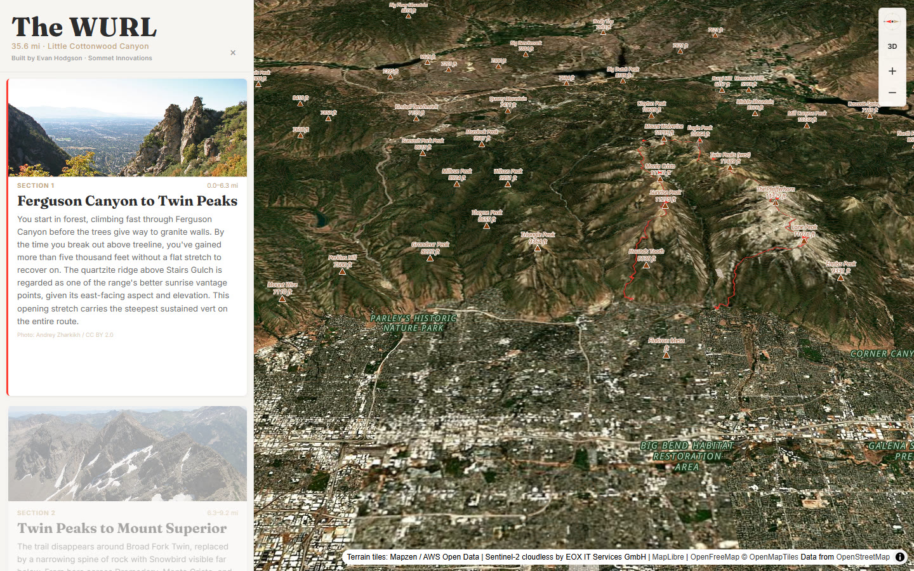

# The WURL — Interactive 3D Course Map

An interactive 3D course map of the **Wasatch Ultimate Ridge Linkup**: 35.6 miles of exposed ridge line across Utah's Wasatch Range.

**[Launch the live map](https://evanehodson.github.io/wurl-course-map/)**



Designed and built by **Evan Hodson** at **Sommet Innovations**.

## What it does

- Renders the route over Sentinel-2 satellite imagery with 3D terrain and a pitched camera.
- Generates contour lines in the browser from terrarium DEM tiles — no pre-baked tileset.
- Drives the map camera, mileage marker, and elevation profile from an eight-section scrollytelling narrative.
- Animates a fly-through along the GPX at 1,200 m/s with interpolated position and bearing.
- Draws a hand-written WebGL torus layer for waypoint labels that sit on the terrain.
- Runs as plain static files: no framework, no bundler, no backend, no API keys.

## Stack

- [MapLibre GL JS](https://maplibre.org/) 4.7.1
- [maplibre-contour](https://github.com/onthegomap/maplibre-contour) 0.1.0
- Vanilla ES modules
- [OpenFreeMap](https://openfreemap.org/) vector tiles / OpenStreetMap data
- [EOX Sentinel-2 cloudless](https://s2maps.eu/) imagery
- AWS Open Data terrain tiles (Mapzen terrarium)
- GitHub Pages

## How it works

**Contours.** `mlcontour.DemSource` wraps the terrarium DEM endpoint, and `contourProtocolUrl` exposes a vector-tile protocol that a web worker fills with contour features. Interval thresholds tighten as zoom increases; elevations are converted to feet for the labels.

**Fly-through.** The GPX is sampled into cumulative distance. At each frame, `interpAt` returns the current position and `sampleBearing` averages a look-ahead window to derive a heading. The camera sits 1,800 m above the route and eases between samples.

**Scrollytelling.** Each narrative section owns a mile range. The active section publishes a single mile value through a small pub/sub layer; the map, marker, profile cursor, and fly-through all subscribe to it. User drag or wheel input sets a "moved from fit" flag so the automatic camera steps aside.

**Waypoints.** The torus layer builds geometry in Mercator space at `map.queryTerrainElevation(...)`, then rebuilds it as the map bearing changes. Labels are rendered to a canvas texture and oriented along the ring.

## Run locally

A local server is required: the map fetches the GPX and uses ES modules.

```bash
npm run dev
# or
python -m http.server 8000
```

Then open <http://localhost:8000>.

## Project structure

```
.
├─ index.html              live map
├─ app.js                  map setup, GPX parsing, profile, state
├─ fly_through.js          cumulative-distance camera animation
├─ scrollytelling.js       eight-section narrative + photos
├─ torus.js                custom WebGL waypoint layer
├─ index.css               map UI
├─ data/
│  └─ WURL_...gpx          route + waypoints
├─ assets/
│  ├─ photos/              self-hosted section photography
│  └─ screenshots/         screenshot used in this README
└─ ...
```

## Data & attribution

- **Route GPX:** exported from AllTrails (`WURL: Wasatch Ultimate Ridge Linkup`). Included for demonstration; route data credited to AllTrails.
- **Section photography:** Flickr, CC BY 2.0 / CC BY-SA 2.0. Per-image credits appear in the map sidebar and in `scrollytelling.js`; images are self-hosted in `assets/photos/`.
- **Imagery:** Sentinel-2 cloudless by EOX IT Services GmbH.
- **Basemap:** OpenFreeMap, data © OpenStreetMap contributors.
- **Terrain:** Mapzen / AWS Open Data terrain tiles.
- **Libraries:** MapLibre GL JS and maplibre-contour.

## License

The code in this repository is released under the [MIT License](LICENSE). Third-party data, imagery, and photography retain their own licenses and attribution requirements; see above.
